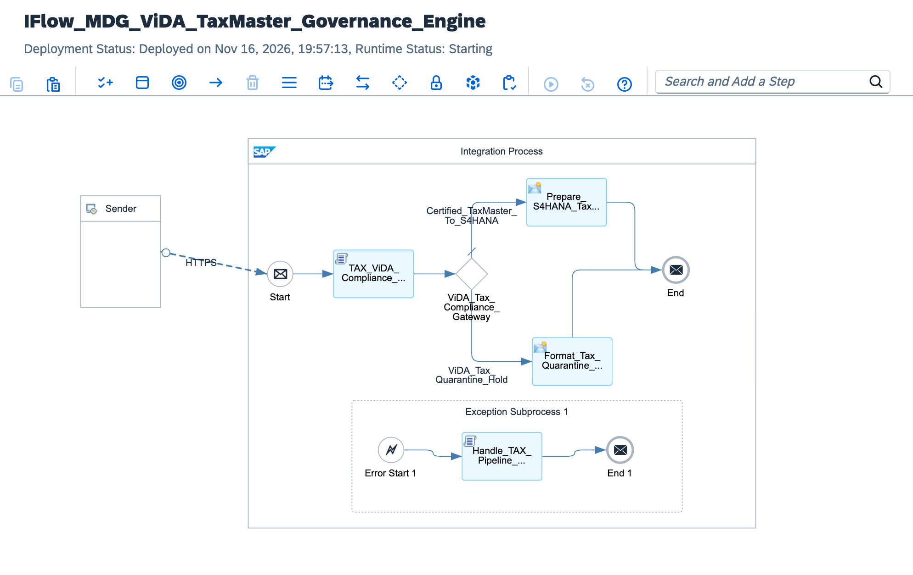

# SAP S/4HANA 2025 MDG EU ViDA Tax Master & Peppol Governance Mesh

[-008FD3?style=for-the-badge&logo=sap&logoColor=white)](https://help.sap.com/docs/cloud-integration)
[](https://api.sap.com/)
[](https://taxation-customs.ec.europa.eu/)
[](https://groovy-lang.org/)
[](https://spockframework.org/)

## Executive Overview

Under the **European Union VAT in the Digital Age (ViDA — Council Directive 2025/516)** framework, cross-border B2B transactions across the EU single market transition to mandatory structured electronic invoicing (**EN 16931**) and near-real-time **Digital Reporting Requirements (DRR)** in 2026–2027. Within **SAP S/4HANA 2025 FPS01**, accurate VAT determination (`TTX1`), reverse-charge postings, and Peppol network routing depend entirely on the integrity of **Business Partner Tax Master (`A_BusinessPartnerTaxNumber`)** records.

Ingesting malformed EU VAT numbers, unregistered Peppol participant endpoints, or unverified e-invoicing capabilities into S/4HANA Finance causes rejected tax filings, blocked customer/vendor invoices, and VAT audit penalties. This repository implements a production-grade **SAP Cloud Integration (CPI)** governance pipeline that validates **ISO 7064 Mod 11,10** EU VIES VAT check digits, verifies **ISO/IEC 6523 Peppol** participant identifiers, enforces **EU ViDA DRR** readiness, and generates canonical **SAP S/4HANA 2025 OData V4** tax master payloads.

---

## End-to-End Architecture Flow

```mermaid
flowchart LR
    subgraph Upstream ["ERP Tax Hubs, CRM & Peppol SMP Directories"]
        A1[SAP MDG / Central Finance Tax Hub]
        A2[Customer & Vendor Onboarding Portals]
        A3[Peppol SML / SMP Participant Registry]
    end

    subgraph CPI ["SAP Integration Suite (Cloud Integration)"]
        B[HTTPS Sender Adapter<br/>/api/v1/mdg/s4hana2025/vida-tax-master]
        C[Groovy 3 Streaming Engine:<br/>TAX_ViDA_Compliance_Validator]
        D{ViDA_Tax_Compliance_Gateway<br/>Exclusive Router}
        E[Content Modifier:<br/>Prepare_S4HANA_Tax_ODataV4<br/>HTTP 201 Certified]
        F[Content Modifier:<br/>Format_Tax_Quarantine_Report<br/>HTTP 422 Rejected]
        G[Exception Subprocess:<br/>Handle_TAX_Pipeline_Exception<br/>HTTP 500 Diagnostics]
    end

    subgraph Core ["SAP S/4HANA 2025 FI-CO & Tax Compliance"]
        H[(SAP S/4HANA 2025 FPS01<br/>A_BusinessPartnerTaxNumber OData V4)]
        I[SAP Document and Reporting<br/>Compliance (DRC) / ViDA DRR]
        J[Tax Master Stewardship<br/>Compliance Quarantine Queue]
    end

    A1 & A2 & A3 -->|HTTPS POST Tax & Peppol Profile JSON| B
    B --> C
    C --> D
    D -->|Default Route:<br/>Certified_TaxMaster_To_S4HANA| E
    D -->|Non-XML Condition:<br/>X-TAX-Gate-Status = 'REJECTED'| F
    E -->|OData V4 Tax Number + ViDA Profile| H & I
    F -->|VIES / ViDA Violation Report| J
    C -.->|Stream / Runtime Exception| G
```

## SAP Cloud Integration (CPI) BPMN2 Integration Flow



---

## Core Architectural Capabilities

### 1. Mathematical EU VIES VAT & ISO 7064 Mod 11,10 Verification
Validates European Union VAT identification numbers (`EuVatNumber`) against country-prefix alignment and executes full **ISO 7064 Mod 11,10** check-digit arithmetic for German *Umsatzsteuer-Identifikationsnummern* (`DE` + 9 digits) alongside canonical EU VIES syntax verification across all 27 Member States.

### 2. ISO/IEC 6523 Peppol Participant Identifier Governance
Enforces strict `ICD:Identifier` syntax and validates International Code Designator (`ICD`) prefixes against official **EU ViDA / Peppol** registries (`0204` German Leitweg-ID, `9930` DE VAT, `0199` ISO 17442 LEI, `0088` EAN/GLN, `9914` AT UID, `0208` BE Enterprise Number, `0106` NL KvK, `0009` FR SIRET).

### 3. EU ViDA (Directive 2025/516) & EN 16931 E-Invoicing Readiness Gate
Verifies that counterparties support approved **EN 16931** semantic invoice syntaxes (`EN16931_UBL_2.1`, `EN16931_CII_D16B`, `XRECHNUNG_3.0`, `FACTUR_X_EN16931`), have activated real-time **Digital Reporting Requirements (DRR)** clearance, and carry valid S/4HANA `TTX1` tax classifications (`1` Liable or `0` Intra-Community Reverse Charge).

### 4. Clean Core S/4HANA 2025 OData V4 (`A_BusinessPartnerTaxNumber`) & SHA-256 Audit Seal
Certified tax profiles are transformed into canonical **SAP S/4HANA 2025 `A_BusinessPartnerTaxNumber`** payloads sealed with a deterministic 64-character **SHA-256** compliance fingerprint (`X-TAX-Compliance-Hash`).

---

## BPMN2 Integration Flow Architecture

| Step | Component Type | Artifact / Step Name | Technical Configuration & Responsibility |
| :--- | :--- | :--- | :--- |
| **1** | **Sender Adapter** | `HTTPS` | Endpoint: `/api/v1/mdg/s4hana2025/vida-tax-master`, Role-Based Auth (`ESBMessaging.send`). |
| **2** | **Groovy Script 1** | `TAX_ViDA_Compliance_Validator` | Streams JSON via `java.io.Reader`, verifies ISO 7064 Mod-11,10 VAT check digits, Peppol ICDs, and EU ViDA DRR readiness. |
| **3** | **Exclusive Router** | `ViDA_Tax_Compliance_Gateway` | Evaluates `X-TAX-Gate-Status`. Default route forwards certified tax records; non-XML condition `${header.X-TAX-Gate-Status} = 'REJECTED'` routes violations. |
| **4a** | **Content Modifier** | `Prepare_S4HANA_Tax_ODataV4` | Sets `Content-Type: application/json` and `CamelHttpResponseCode: 201` for S/4HANA 2025 OData V4 persistence. |
| **4b** | **Content Modifier** | `Format_Tax_Quarantine_Report` | Sets `Content-Type: application/json` and `CamelHttpResponseCode: 422` for Tax Stewardship quarantine. |
| **5** | **Exception Subprocess** | `Handle_TAX_Pipeline_Exception` | Captures `CamelExceptionCaught` runtime faults and returns structured `HTTP 500` JSON diagnostics. |

---

## Payload Contracts & Runtime Verification

### Scenario A: Certified EU ViDA & VIES Tax Master (`HTTP 201 Certified`)

**Inbound Request (`POST /http/api/v1/mdg/s4hana2025/vida-tax-master`):**
```json
{
  "BusinessPartner": "BP-10004829",
  "Country": "DE",
  "EuVatNumber": "DE136695976",
  "PeppolParticipantId": "0204:991-12345-67",
  "StructuredInvoiceFormat": "XRECHNUNG_3.0",
  "TaxClassificationCode": "1",
  "VidaDigitalReportingReady": true
}
```

**Outbound S/4HANA 2025 OData V4 + ViDA Payload (`HTTP 201`):**
```json
{
  "@odata.context": "$metadata#A_BusinessPartnerTaxNumber/$entity",
  "BusinessPartner": "BP-10004829",
  "BPTaxType": "DE0",
  "BPTaxNumber": "DE136695976",
  "TaxComplianceFingerprint": "6e2a9c4f1d8b7035a1c9e4f7b2d5e8a1c3f6b9d2e5a8c1f4b7d0e3a6c9f2b5d8",
  "to_TaxClassification": {
    "DepartureCountry": "DE",
    "CustomerTaxCategory": "TTX1",
    "TaxClassification": "1"
  },
  "EuVidaDigitalReportingExtension": {
    "VidaDirectiveStatus": "COMPLIANT_2026_2027",
    "PeppolParticipantId": "0204:991-12345-67",
    "StructuredInvoiceSyntax": "XRECHNUNG_3.0",
    "DigitalReportingClearance": "ACTIVE",
    "VerifiedAt": "2026-11-16T18:57:13Z"
  }
}
```

---

### Scenario B: Invalid VAT Check-Digit & Non-Compliant E-Invoicing (`HTTP 422 Rejected`)

**Inbound Request:**
```json
{
  "BusinessPartner": "BP-99900112",
  "Country": "DE",
  "EuVatNumber": "DE136695970",
  "PeppolParticipantId": "8888:INVALID",
  "StructuredInvoiceFormat": "UNSTRUCTURED_PDF",
  "TaxClassificationCode": "9",
  "VidaDigitalReportingReady": false
}
```

**Outbound Tax Quarantine Report (`HTTP 422`):**
```json
{
  "status": "QUARANTINED_VIDA_TAX_GOVERNANCE_HOLD",
  "regulation": "EU_VIDA_DIRECTIVE_2025_516_AND_EN16931",
  "timestamp": "2026-11-16T18:58:02Z",
  "businessPartner": "BP-99900112",
  "euVatNumber": "DE136695970",
  "taxComplianceSha256": "3b7f1e9c2a4d6035e1a9c4f7b2d5e8a1c3f6b9d2e5a8c1f4b7d0e3a6c9f2b5d8",
  "violations": [
    "INVALID_EU_VIES_VAT: Failed EU VIES format or ISO 7064 Mod-11,10 check-digit verification for [DE136695970].",
    "UNSUPPORTED_PEPPOL_ICD: ICD prefix [8888] is not registered in EU ViDA SMP directory.",
    "VIDA_UNSUPPORTED_EINVOICE_SYNTAX: StructuredInvoiceFormat [UNSTRUCTURED_PDF] must comply with EN 16931 semantic model.",
    "VIDA_DRR_NOT_ENABLED: Counterparty has not enabled real-time Digital Reporting Requirements (DRR) clearance.",
    "INVALID_S4_TAX_CLASSIFICATION: TaxClassificationCode [9] must be '1' (Liable) or '0' (Intra-Community Reverse Charge)."
  ]
}
```

---

## Local Test-Driven Development (Spock Framework)

All Groovy 3 `Reader`-streamed validation rules, ISO 7064 Mod 11,10 VAT check-digit logic, and Peppol ICD checks are verified locally via **Gradle** and **Spock Framework 2.3**:

```bash
gradle test --info
```

### Verified Test Specifications (`VidaTaxMasterValidatorSpec.groovy`)
- `Should certify valid EU ViDA tax master profile with ISO 7064 Mod-11,10 German VAT and Peppol ICD`
- `Should reject German VAT number failing ISO 7064 Mod-11,10 check-digit verification`
- `Should quarantine counterparty failing EU ViDA EN 16931 e-invoice syntax or DRR readiness`

---

## Repository Structure

```text
sap-cpi-mdg-eu-vida-tax-master-governance-mesh/
├── artifacts/
│   └── IFlow_MDG_ViDA_TaxMaster_Governance_Engine.zip        # Exported SAP CPI BPMN2 package
├── docs/
│   └── adr/
│       └── 001-eu-vida-tax-master-and-peppol-gating.md
├── src/
│   ├── main/
│   │   └── groovy/
│   │       ├── TAX_ViDA_Compliance_Validator.groovy          # Groovy 3 streaming ViDA & VIES validator
│   │       └── Handle_TAX_Pipeline_Exception.groovy          # Structured HTTP 500 error handler
│   └── test/
│       └── groovy/
│           ├── com/sap/gateway/ip/core/customdev/util/
│           │   └── Message.groovy                            # SAP CPI Message stub (Reader-enabled)
│           └── VidaTaxMasterValidatorSpec.groovy             # Spock Framework TDD unit tests
├── build.gradle                                              # Groovy 3 & Spock 2.3 build descriptor
├── iflow-bpmn2-diagram.png                                   # SAP CPI BPMN2 flow screenshot
└── README.md
```

---

**Author:** Željko Popov  
*Integration & SAP S/4HANA Clean Core Architect*
